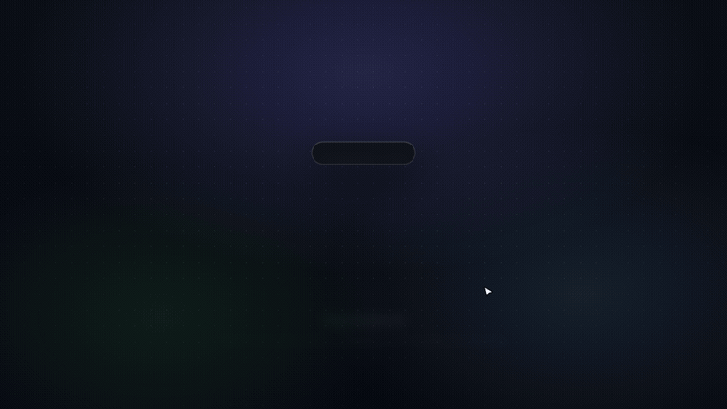

<div align="center">

# 🏝️ OpenIsland

**Нативный Dynamic Island для Windows 10/11 + пульт управления ИИ-агентом OpenCode**

[](https://github.com/mmmatveyz/OpenIsland/releases/latest)
[](https://github.com/mmmatveyz/OpenIsland/releases/latest)
[](#%EF%B8%8F-стек-сборка-и-аргументы-запуска)
[](./LICENSE)

**[⬇️ Скачать последний релиз](https://github.com/mmmatveyz/OpenIsland/releases/latest)** · **[🗺️ Roadmap](./docs/ROADMAP.md)** · **[🏗️ Архитектура](./docs/ARCHITECTURE.md)**

<br/>



<sub>🎬 <a href="./docs/media/openisland-promo.mp4">Смотреть промо-ролик в 60 fps (MP4)</a></sub>

</div>

---

## ✨ Возможности

- **🎵 Музыка и живой спектр** — обложка, управление и реальный WASAPI-эквалайзер на **любой** системный звук. Работает с Spotify, браузерами, а также с **AIMP и Winamp** (через Winamp IPC).
- **🤖 OpenCode AI Hub (`Ctrl+Alt+O`)** — локальный ИИ-агент прямо в островке: список сессий с поиском, выбор модели, живой SSE-стриминг ответа, просмотр диффов и подтверждение разрешений в один клик.
- **🧰 Виджеты на каждый день** — таймер, погода (Open-Meteo), полка файлов (drag & drop), мониторинг ПК (CPU/RAM/GPU/диск/сеть/t°), процессы и порты, история буфера обмена, быстрый запуск, экранная пипетка (`Ctrl+Alt+C`) и OCR (`Ctrl+Alt+X`).
- **🎨 Полная кастомизация** — Тёмная, Светлая и Авто тема (подстраивается под Windows), палитры (`Обсидиан`, `OLED`, `Nord`, `Cyberpunk`), 4 формы капсулы (`Сквиркл`, `Капсула`, `Fluent`, `Строгая`), 3 стиля стекла и скрытие ненужных виджетов.
- **⚡ Нативный и лёгкий** — C# WPF (.NET 8) с пружинной физикой, ~0–0.5% CPU в фоне, автоскрытие в играх, сквозной режим кликов (`Ctrl+Alt+I`), защита от записи экрана и автообновление с проверкой `sha256`.

---

## 🚀 Быстрый старт

1. Скачайте [**OpenIslandSetup-1.3.6.exe**](https://github.com/mmmatveyz/OpenIsland/releases/latest) (установка без прав администратора) или portable-версию `OpenIsland.exe`.
2. Запустите — островок появится по центру верхней кромки экрана.
3. Для работы **AI Hub** достаточно запущенного OpenCode Desktop или демона `opencode` (авторизация через DPAPI выполняется автоматически). Остальные виджеты работают полностью автономно.

---

## 📖 Подробности (нажмите, чтобы раскрыть)

<details>
<summary><b>🎮 Управление, жесты и горячие клавиши</b></summary>

| Действие | Результат |
| :--- | :--- |
| **Клик по островку** | Раскрыть плеер / таймер / OpenCode (или меню в простое) |
| **Потянуть вниз** | Пружинное раскрытие карточки или отскок назад |
| **Толкнуть влево / вправо** | Следующий или предыдущий трек при воспроизведении |
| **Правый клик** | Главное меню (виджеты, настройки, оформление, выход) |
| **Клик колесом** | Спрятать островок на 5 секунд |
| **Колесо мыши** | Громкость (над свёрнутым/плеером) или плавная прокрутка (в меню настроек/оформления) |
| **Ctrl + колесо** | Переключение активного аудиоисточника по кругу |
| **`Ctrl + Alt + O`** | Открыть или свернуть карточку OpenCode AI Hub |
| **`Ctrl + Alt + I`** | Сквозной режим (клики проходят сквозь остров) |
| **`Ctrl + Alt + C`** | Экранная пипетка цвета с лупой (HEX / RGB в буфер) |
| **`Ctrl + Alt + X`** | Экранный снимок с распознаванием текста (Windows OCR) |

</details>

<details>
<summary><b>🧩 Подробно о виджетах и интеграциях</b></summary>

- **Плеер и WASAPI-эквалайзер:** цвет полос и ободка подстраивается под обложку трека. Если в системе играет видео или игра без медиасессии, остров разворачивается в мини-капсулу с эквалайзером. Захват звука останавливается, когда остров скрыт.
- **OpenCode AI Hub:** поиск сессий (при 8+), загрузка истории страницами по 40 сообщений, просмотр патчей (`/diff`), звук завершения (`staplebops-01`) и тихий Windows-тост при задачах дольше 15 секунд.
- **Полка файлов (File Shelf):** приём файлов перетаскиванием на остров, сохранение списка в реестре и обратный drag-out в Telegram, Discord или любое окно.
- **Погода:** температура, ощущение, ветер, влажность, осадки и почасовой прогноз на 24 часа без API-ключей. Автоопределение по IP или ручной поиск города.
- **Мониторинг ПК и процессы:** CPU по ядрам, RAM, GPU, диск, сеть и температура (опрашиваются **только** пока карточка открыта). Отдельная карточка dev-процессов и слушающих локальных портов (через IP Helper API) с завершением в два клика.
- **Буфер обмена:** последние 30 фрагментов текста (только в оперативной памяти процесса, без записи на диск).
- **Быстрый запуск:** 8 системных утилит + добавление своих `.exe` / `.lnk` / `.bat` / `.cmd`.

</details>

<details>
<summary><b>🛠️ Стек, сборка из исходников и аргументы запуска</b></summary>

### Стек технологий
- **Платформа:** C# WPF, .NET 8 (`net8.0-windows10.0.19041.0`), Windows 10 (2004+) / Windows 11.
- **Рендеринг:** Direct3D через WPF, Windows.UI.Composition (acrylic), кастомные `DrawingVisual`-виджеты.
- **Безопасность:** токен OpenCode шифруется через Windows DPAPI (`%LOCALAPPDATA%\OpenIsland\opencode-token.bin`). Настройки в `HKCU\Software\OpenIsland`. Логи в `%LOCALAPPDATA%\OpenIsland\logs\app.log`.

### Команды сборки
Если .NET 8 SDK не установлен, скрипт автоматически скачает его в локальную папку `.dotnet/`.

```powershell
# Сборка Release в bin\OpenIsland
powershell -NoProfile -ExecutionPolicy Bypass -File scripts\build.ps1

# Сборка и запуск
powershell -NoProfile -ExecutionPolicy Bypass -File scripts\build.ps1 -Run

# Прогон всех 271 юнит-тестов (xUnit)
powershell -NoProfile -ExecutionPolicy Bypass -File scripts\build.ps1 -Test

# Диагностика OpenCode (--selftest)
powershell -NoProfile -ExecutionPolicy Bypass -File scripts\build.ps1 -SelfTest

# Сборка установщика (требуется Inno Setup 6)
powershell -NoProfile -ExecutionPolicy Bypass -File scripts\build.ps1 -Installer
```

### Аргументы запуска
| Аргумент | Назначение |
| :--- | :--- |
| `--view OpenCodeBig` / `Perf` / `Clipboard` / `Processes` / `QuickLaunch` | Открыть сразу нужную карточку |
| `--view Sound` | Показать капсулу эквалайзера для проверки |
| `--clickthrough` | Запустить сразу в сквозном режиме |
| `--selftest` | Headless-проверка интеграции с OpenCode |

</details>

<details>
<summary><b>📂 Структура репозитория, ресурсы и благодарности</b></summary>

```text
OpenIsland/
├── desktop/OpenIsland/         # Основное приложение (C# WPF)
├── tests/OpenIsland.Tests/     # Юнит-тесты (xUnit)
├── installer/OpenIsland.iss    # Скрипт установщика Inno Setup
├── scripts/build.ps1           # Сборка, тесты и упаковка
├── docs/                       # Архитектура, Product Map, Roadmap, медиа
└── Запуск_OpenIsland.bat       # Запуск в один клик
```

- **Шрифты и иконки:** Inter ([OFL](https://github.com/rsms/inter)) и Phosphor Fill ([MIT](https://github.com/phosphor-icons/web)).
- **3D-модели наушников:** Sketchfab ([CC BY 4.0](https://creativecommons.org/licenses/by/4.0/)).
- **Звук завершения:** `staplebops-01.mp3` из [sst/opencode](https://github.com/sst/opencode) (MIT).
- **Основа UI-ядра:** вдохновлено и выросло из апстрима `mihailkotovski/DynamicIsland`.
- **Безопасность:** об уязвимостях сообщайте согласно [SECURITY.md](./SECURITY.md).

</details>

---

<div align="center">
<sub>MIT License · Copyright © 2026 OpenIsland · <a href="./docs/PRODUCT.md">Product Map</a> · <a href="./docs/ROADMAP.md">Roadmap</a></sub>
</div>
