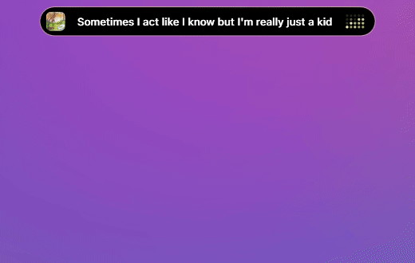
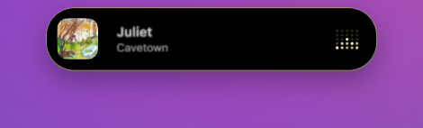
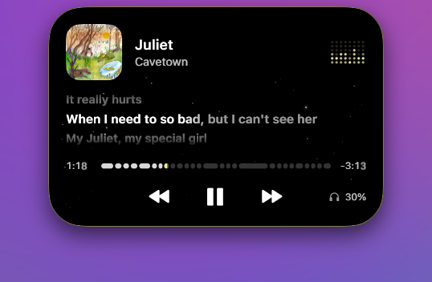
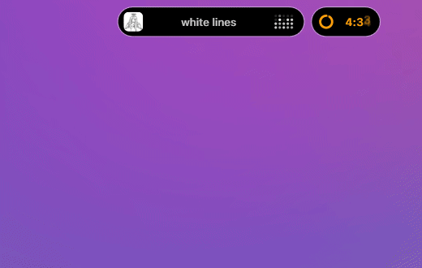
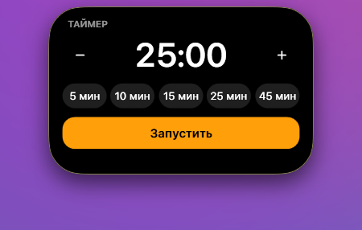
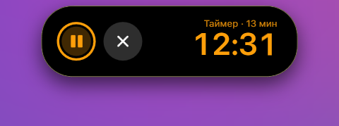
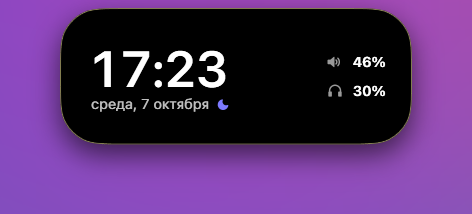
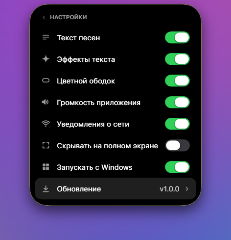
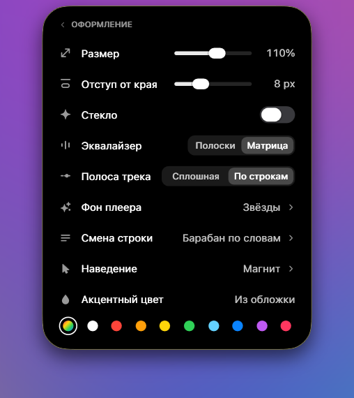

<div align="center">

<h1>OpenIsland</h1>

<p>Остров в духе iPhone у верхнего края экрана для Windows 10/11: музыка с живым эквалайзером, таймер, системный статус и пульт локального ИИ-агента OpenCode — прямо из капсулы. По клику раскрывается в плеер и карточки.</p>

<p>
  
  
  
</p>



<p>
  <a href="#что-умеет">Что умеет</a>
  &nbsp;·&nbsp; <a href="#управление">Управление</a>
  &nbsp;·&nbsp; <a href="#сборка-из-исходников">Сборка</a>
  &nbsp;·&nbsp; <a href="#конфиденциальность">Конфиденциальность</a>
</p>

</div>

Это README относится к папке `desktop/OpenIsland` — основному нативному приложению. Общий обзор проекта, стек и структура репозитория — в [корневом README](../../README.md).

Написан на WPF (.NET 8) почти без сторонних пакетов — только Windows API и единственная зависимость `System.Management` (температура через WMI). Один exe, установка не нужна.

## Что умеет

### Музыка и эквалайзер

<table>
  <tr>
    <td align="center"><br><sub>Обложка, название и живой эквалайзер</sub></td>
    <td align="center"><br><sub>Раскрытый плеер</sub></td>
  </tr>
</table>

- **Музыка.** Обложка, название и эквалайзер для любого приложения с системной медиасессией (Spotify, браузер, Яндекс Музыка…). Цвет полосок берётся из обложки, и в тот же цвет окрашивается светлый ободок острова. При смене трека новая обложка выталкивает старую — влево для следующего трека, вправо для предыдущего. Обложка и полоски одни на остров, тост и плеер: между ними они не гаснут и не появляются заново, а переезжают и меняют размер вместе с формой острова.
- **Живой эквалайзер.** Полоски считаются по реальному выводу звука (WASAPI loopback), а не случайно.
- **Эквалайзер на любой звук.** Если в системе что-то играет без активной медиасессии — видео в браузере, игра, голосовой чат — свёрнутый островок разворачивается в компактную капсулу с одними полосками. Она реагирует на **весь** системный вывод, а не только на треки. Детект — по дешёвому пику устройства (`IAudioMeterInformation`, опрос 100 мс); тяжёлый захват звука включается только пока капсула видна.
- **Плеер.** По клику — большая обложка, перемотка, «назад / пауза / вперёд» и подсветка в цветах обложки, которая движется под звук. На паузе обложка отступает — становится меньше — и возвращается с отскоком, когда музыка играет дальше.
- **Несколько источников.** Если музыка есть сразу в нескольких приложениях (Spotify и вкладка браузера), Ctrl + колесо над островом листает их по кругу; остров называет приложение, к которому перешёл.

### Жесты и форма

<p align="center"></p>

- **Жесты.** Остров можно взять мышью. Потянуть вниз — он тянется за указателем, чем дальше, тем неохотнее, и, отпущенный достаточно далеко или брошенный коротким рывком, раскрывается с той скоростью, с какой его отпустили; не дотянутый — пружинит обратно. Толкнуть вбок, пока играет музыка, — следующий трек (влево) или предыдущий (вправо).
- **Форма.** Ширина и высота острова движутся порознь: раскрываясь, он сначала раздаётся вширь, чуть дальше своей ширины, и следом опускается; сворачиваясь — сначала подбирается вверх и потом сужается.

### Таймер и пузыри

<p align="center"></p>

<table>
  <tr>
    <td align="center"><br><sub>Настройка: от 1 до 99 минут</sub></td>
    <td align="center"><br><sub>Кольцо прогресса и отсчёт</sub></td>
  </tr>
</table>

- **Таймер и секундомер.** Пресеты от 1 до 99 минут, пауза, кольцо прогресса. Когда время выходит, таймер отделяется от острова пузырём, звонит и пульсирует; клик по нему выключает звонок. В настройке таймера колесо мыши меняет минуты.
- **Пузыри.** Уведомления о таймере, громкости и наушниках выезжают из острова отдельным пузырём и не мешают основной капсуле.

### Системный статус

<table>
  <tr>
    <td align="center"><br><sub>Часы, заряд и индикаторы</sub></td>
    <td align="center"><br><sub>Громкость колесом</sub></td>
  </tr>
</table>

- **Часы.** В свёрнутом острове — часы.
- **Громкость.** Колесо мыши над островом меняет общую громкость; над раскрытым плеером — громкость играющего приложения.
- **Заряд и наушники.** Индикатор заряда; при подключении наушников — уведомление с 3D-моделью (вкладыши, накладные, колонка).
- **Сеть и DND.** Индикатор сети и режима «не беспокоить».

### Мониторинг ПК и буфер обмена

- **Мониторинг ПК.** Карточка из меню показывает нагрузку процессора, память (занято/всего и %), видеокарту, сеть (↓/↑) и температуру с полосками-индикаторами. Данные читаются только пока карточка открыта, поэтому в фоне остров остаётся лёгким. Температура через WMI есть не на всех машинах — тогда показывается «н/д».
- **Буфер обмена.** Вторая карточка — история последних 30 фрагментов текста с временем («сейчас», «5 мин»). Клик возвращает фрагмент в буфер, «Очистить» сбрасывает историю. Захват включается подпиской окна на `WM_CLIPBOARDUPDATE`, поэтому история копится, даже пока карточка закрыта. Ничего не пишется на диск или в логи: история живёт только в памяти процесса. Отключается переключателем «История буфера» в настройках (при выключении история очищается).

### Оформление и настройки

<table>
  <tr>
    <td align="center"><br><sub>Настройки</sub></td>
    <td align="center"><br><sub>Оформление</sub></td>
  </tr>
</table>

- **Настройки.** Цветной ободок, громкость приложения в плеере, уведомления о сети и о завершении задач, история буфера, скрытие на полном экране и автозапуск выключаются на странице «Настройки» в меню.
- **Оформление.** На соседней странице меню — размер острова и отступ от верхнего края экрана (ползунком, чья ручка, пока её держат, превращается в линзу), матовое стекло под островом, вид эквалайзера (полоски или «матрица» точек), фон плеера (свечение, матрица, звёзды), отклик кнопок на указатель (диск, магнит, перетекание) и акцентный цвет вместо цветов обложки. Варианты с картинками показываются в полоске плиток.
- **Обновление.** Последняя строка страницы «Настройки» показывает версию острова. Приложение проверяет релизы в [mmmatveyz/OpenIsland](https://github.com/mmmatveyz/OpenIsland), скачивает ассет `OpenIsland.exe` и сверяет `sha256`-дайджест перед подменой файла.

### OpenCode AI Hub

- **Подключение.** Остров сам находит локальный демон OpenCode (`opencode service status`), проверяет `/api/info` и при необходимости выполняет автоматический пейринг (`opencode pair`). Токен хранится зашифрованным через Windows DPAPI.
- **Сессии и модели.** Счётчик и переключение сессий (`‹ 1 / 6 ›`), создание и удаление сессии, выбор модели — прямо из карточки.
- **Задачи и ответ.** Поле ввода («Enter» — отправить), живой стриминг ответа агента через SSE, кнопка «Стоп» для прерывания.
- **Разрешения.** Запросы доступа агента («Разрешить» / «Отклонить») без переключения в OpenCode Desktop.
- **Задача агенту.** Текст уходит в выбранную сессию OpenCode как есть; роль и контекст задаются промптом.
- **Звук завершения.** Когда агент заканчивает задачу, играет тот же короткий звук, что и в самом OpenCode — `staplebops-01` (лицензия MIT, проект [sst/opencode](https://github.com/sst/opencode)). Файл лежит в `Assets/staplebops-01.mp3`, встроен в exe и один раз выгружается в `%LOCALAPPDATA%\OpenIsland\staplebops-01.mp3`.
- **Тост о завершении.** Если задача выполнялась дольше 15 секунд, вместе со звуком показывается Windows-уведомление через иконку трея. Отключается переключателем «Уведомления о задачах» в настройках.
- **Хоткей.** Глобальный **Ctrl+Alt+O** мгновенно открывает или сворачивает карточку OpenCode из любого приложения.
- **Офлайн.** Если демон OpenCode не запущен, карточка честно сообщает «OpenCode не запущен»: навигация по сессиям/моделям, ввод и «Отправить» отключаются, а акцентная кнопка «Запустить OpenCode» поднимает приложение. После старта демона островок подключается сам. Клик по островку при закрытом OpenCode открывает меню, а не пустую карточку агента.

## Управление

| Действие | Результат |
| --- | --- |
| Клик | Раскрыть плеер или таймер, повторный клик — свернуть |
| Потянуть остров вниз | Раскрыть то же, что и клик: оттянуть подальше и отпустить, или бросить коротким рывком |
| Толкнуть остров влево или вправо | Следующий или предыдущий трек, пока играет музыка |
| Клик по обложке в плеере | Открыть приложение, в котором играет музыка |
| Правый клик | Меню: таймер, настройки, оформление, OpenCode, буфер обмена, мониторинг ПК, закрыть остров; со страницы-карточки — назад в меню |
| Клик колесом | Спрятать остров на 5 секунд |
| Колесо мыши | Громкость: общая, над раскрытым плеером — играющего приложения (в настройке таймера — минуты, на странице оформления — значение строки под курсором) |
| Ctrl + колесо | Следующее или предыдущее приложение с музыкой |
| Клик по звонящему таймеру | Выключить звонок |
| Клик по пузырю | Открыть ту часть, по которой кликнули |

## Сборка из исходников

Из корня репозитория:

```powershell
# Сборка Release в bin\OpenIsland
powershell -NoProfile -ExecutionPolicy Bypass -File scripts\build.ps1

# Сборка и немедленный запуск
powershell -NoProfile -ExecutionPolicy Bypass -File scripts\build.ps1 -Run

# Диагностика интеграции с OpenCode
powershell -NoProfile -ExecutionPolicy Bypass -File scripts\build.ps1 -SelfTest
```

Если .NET 8 SDK не установлен в системе, `scripts\build.ps1` скачает его в локальную папку `.dotnet/`.

Отдельный exe, которому не нужен установленный .NET:

```powershell
dotnet publish desktop\OpenIsland\OpenIsland.csproj -c Release -r win-x64 --self-contained true -p:PublishSingleFile=true -p:IncludeNativeLibrariesForSelfExtract=true -p:EnableCompressionInSingleFile=true -o publish
```

### Аргументы запуска

| Аргумент | Назначение |
| :--- | :--- |
| `--view OpenCodeBig` | Открыть сразу карточку OpenCode AI Hub |
| `--view Sound` | Принудительно показать капсулу эквалайзера (для проверки) |
| `--view Perf` | Открыть сразу карточку мониторинга ПК |
| `--view Clipboard` | Открыть сразу карточку буфера обмена |
| `--selftest` | Headless-проверка OpenCode (сессии, модели, промпт, ответ) |

Логи приложения: `%LOCALAPPDATA%\OpenIsland\logs\app.log` (ротация при 1 МБ).

## Шрифты, графика и звук

- **Шрифт.** Текст — **Inter** (свободная лицензия [OFL](https://github.com/rsms/inter)), иконки — **Phosphor Fill** (лицензия [MIT](https://github.com/phosphor-icons/web)). Файлы лежат в [Fonts](Fonts/) и встраиваются в exe при сборке; Inter задан в `MainWindow.xaml`, глифы Phosphor — в `Icon.cs`. Волны громкости и wifi рисуются собственными контурами в коде. Без этих файлов текст рисуется `Segoe UI Variable`, а иконок не будет.
- **Модели наушников.** Кадры поворота готовых 3D-моделей с [Sketchfab](https://sketchfab.com), отрендеренные в Blender: по 81 кадру через 2° в [Gadgets](Gadgets/), они тоже встраиваются в exe. Модели распространяются по лицензии [CC BY 4.0](https://creativecommons.org/licenses/by/4.0/):
  - вкладыши — [«AirPods (3ᵉ génération)»](https://sketchfab.com/3d-models/airpods-3e-generation-ed331e742ab944e683dcddd59ab0713e), автор [polyman](https://sketchfab.com/Polyman_3D); кейс убран;
  - накладные — [«Airpods max sky blue»](https://sketchfab.com/3d-models/airpods-max-sky-blue-3d0643db08fc4ef89bda55a74077ece4), автор [polyman](https://sketchfab.com/ely.haddad); перекрашены в серебро;
  - колонка — [«JBL Charge 3 speaker»](https://sketchfab.com/3d-models/jbl-charge-3-speaker-661f85fe3e4048f59785b2a75ffa52f8), автор [Aleksei Rozumnyi](https://sketchfab.com/Aleksei.Rozumnyi).
- **Звук завершения.** `Assets/staplebops-01.mp3` — звук завершения задачи из [OpenCode](https://github.com/sst/opencode) (sst), лицензия MIT. Встроен в exe как WPF-ресурс и выгружается в кэш при первом обращении.

## Конфиденциальность

Остров общается только с локальным демоном OpenCode на `127.0.0.1`. Внешних интеграций (погода, тексты песен) в проекте нет. Токен OpenCode хранится только в зашифрованном виде через Windows DPAPI (`%LOCALAPPDATA%\OpenIsland\opencode-token.bin`) и никогда не попадает в логи. История буфера обмена живёт только в памяти процесса и не пишется на диск или в логи. Единственный внешний запрос — проверка обновлений в GitHub Releases ([mmmatveyz/OpenIsland](https://github.com/mmmatveyz/OpenIsland)).

## Лицензия

MIT License.
